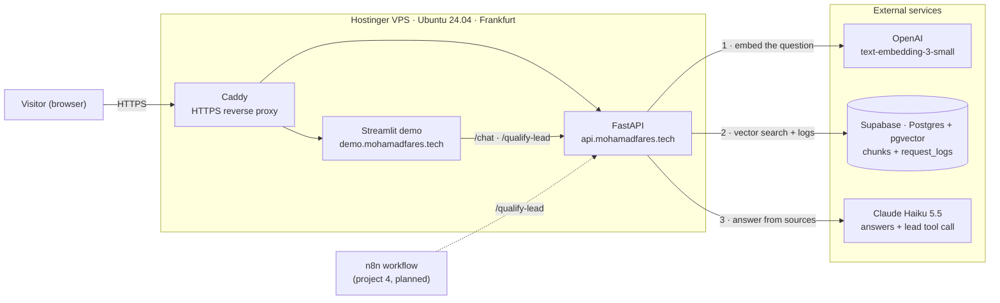

# Cedar Ridge AI Assistant

An AI assistant for a home-improvement company that answers website visitors from the company's own documents, cites its sources, hands over to a human when it doesn't know, and turns each conversation into a structured lead record.

> Cedar Ridge Roofing & Renovation (Columbus, Ohio) is a fictional company used as demo data. The code is company-agnostic.

## 🌍 Live demo
- **Chat demo:** https://demo.mohamadfares.tech: ask questions, or open the **Sales team view** to see a chat turned into a qualified lead
- **API docs:** https://api.mohamadfares.tech/docs: try `/chat` and `/qualify-lead` directly

Runs on my own VPS (always on, HTTPS). Backup copies on free hosting (may take ~1 minute to wake up): [Streamlit Cloud](https://ai-lead-assistant.streamlit.app) · [Render API](https://ai-lead-assistant-v79o.onrender.com/docs)

## Problem
Home-improvement companies get website visitors at all hours asking the same questions: service areas, price ranges, financing, warranties. Slow answers lose leads to competitors, and the sales team wastes time on visitors who are outside the service area or not ready to buy.

## Aim
- Answer visitor questions **only** from company documents, with **citations**
- **Hand over to a human** when the documents don't contain the answer
- Produce a **Pydantic-validated JSON lead summary** (service, location, budget, urgency, qualified)
- Log **tokens, cost and latency** for every request
- Measure quality with an **evaluation set** of 40 questions
- Serve it as a **FastAPI** service (used by an n8n automation in project 4) with a **Streamlit** demo

## Architecture

Both apps listen only on `127.0.0.1`; Caddy is the only public entry. Backup copies run on Render (API) and Streamlit Cloud (demo).

## How it works
1. **Knowledge base:** 7 Markdown documents, split into 38 chunks by `##` section (`app/chunking.py`)
2. **Embeddings:** each chunk becomes a 1,536-number vector with OpenAI `text-embedding-3-small` (`app/embeddings.py`)
3. **Storage and search:** chunks + vectors in Supabase (Postgres + pgvector); a SQL function `match_chunks` ranks them by cosine similarity (`sql/schema.sql`, `scripts/ingest.py`, `app/retrieval.py`)
4. **Grounded answers:** the top 5 chunks go to Claude Haiku 5.5 as numbered sources; the answer cites them as [1], [2]... and the API returns **only the sources the answer actually cites**. Off-topic questions (very low similarity) hand over without calling Claude; when the documents don't contain what was asked, Claude adds a `[HANDOFF]` marker that the code removes and turns into `handoff: true` (`app/answer.py`)
5. **Lead summary:** a forced tool call fills a Pydantic `LeadSummary` schema; Python rules decide if the lead is qualified and why (`app/schemas.py`, `app/lead.py`)
6. **API:** FastAPI with input limits, safe error messages (503), timeouts, retries, and a cost/latency log per request (`app/main.py`, `app/costs.py`, `app/logs.py`)
7. **Demo UI:** a Streamlit app with two pages: a customer chat (sources, handoff box, example questions) and a sales team view that qualifies a lead from a sample or from your own chat (`frontend/streamlit_app.py`)

Design decisions and trade-offs are logged in [`decisions.md`](decisions.md).

## API
| Method | Endpoint | What it does |
|---|---|---|
| GET | `/health` | Check that the server is running |
| POST | `/chat` | `{"question": "..."}` → answer, cited sources, handoff flag |
| POST | `/qualify-lead` | `{"conversation": "..."}` → lead summary, qualified, reasons |

Invalid input returns **422**; if Claude, OpenAI or the database fail, the API returns a safe **503** message and the details go to the server logs only.

## Evaluation
40 test questions with known answers (`eval/questions.json`): 20 answerable, 5 clear "no", 9 knowledge gaps, 4 multi-part, 2 off-topic. Run with `python -m eval.run_eval`.

| Metric | Result |
|---|---|
| Retrieval hit (right chunk in top 5) | 28 / 29 (97%) |
| Correct facts in the answer | 28 / 29 (97%) |
| Correct handoff (only when it should) | 39 / 40 (98%) |
| Median latency | 1.4 s |

**How the numbers improved:** baseline (threshold 0.35, top 3) refused two valid questions → threshold tuned to 0.20 from measured score distributions → top-5 retrieval fixed one multi-part miss. Adding the explicit `[HANDOFF]` signal first over-flagged clear "no" answers (handoff 37/40); a precise prompt rule fixed it. The one remaining miss (q35) is the retrieval limitation below: the bot now honestly flags the part it couldn't find. Every change was re-measured on the full set.

## Cost and latency
Every request is logged to a `request_logs` table (endpoint, latency, input/output tokens, estimated cost, outcome).

| Endpoint | Typical cost | Typical latency |
|---|---|---|
| `/chat` | ~$0.0002 | 1.5–3 s |
| `/qualify-lead` | ~$0.0002 | 1–2 s |

≈ 5,000 answers per $1.

## Tests
14 pytest tests (`tests/`), run with `python -m pytest`:
- **Lead rules:** town normalization, qualified lead, missing contact, outside the service area, unknown town
- **API:** health check, empty and too-long input (422), internal usage data hidden from the response, safe 503 when the AI call fails
- **Citations:** only cited sources kept with their numbers, duplicates once, no citations → empty, out-of-range numbers ignored

The tests replace the AI calls with fakes (monkeypatch), so they are fast, free and repeatable. They pass both locally (Windows) and on the server (Ubuntu).

## Deployment
- **VPS (main):** Hostinger KVM 1, Ubuntu 24.04 LTS, Frankfurt. Hardened (SSH keys only, no root login, `ufw` firewall with only 22/80/443 open). FastAPI and Streamlit run as **systemd** services bound to `127.0.0.1`; **Caddy** is the reverse proxy with automatic HTTPS (Let's Encrypt) for `api.` and `demo.mohamadfares.tech`. Secrets in a server-side `.env` with `chmod 600`; logs via `journalctl`. Updates: `git pull` + `systemctl restart`.
- **Render** (backup API): free tier, Frankfurt, next to the database, auto-deploys on every push to `main`
- **Streamlit Community Cloud** (backup demo): hosts the UI from `frontend/` (its own `requirements.txt`, theme in `.streamlit/config.toml`); it only calls the API, so it holds no keys
- The frontend reads `API_URL` / `PUBLIC_API_URL` from the environment, so the same code runs on every host
- Python pinned with `.python-version` (3.13)
- **Separate production keys**, stored only on the servers (Render settings, VPS `.env`) and in a password manager; dev keys stay in a local `.env` that is never committed. Keys are rotated before they expire (new key → switch → test → delete old)
- **UptimeRobot** checks the Render `/health` every 5 minutes: keeps the free API awake and emails an alert if it goes down

## Code review
The code was reviewed with Claude Code as a **read-only reviewer** (no edit or shell permissions, `.env` blocked). It found 8 issues; all 8 are fixed (the last one: the API now returns only the sources the answer cites).

## Limitations
- One multi-part question (q35) still misses a source (one question = one search vector); candidate fix: split the question into parts before searching
- Evaluation uses keyword checks (cheap but brittle); next step is an LLM-as-judge
- The `[HANDOFF]` signal relies on Claude following a prompt rule; the evaluation measures it on every change
- The API is public with no authentication or rate limiting; a real deployment would add an API key and rate limits
- The **Sales team view** is a demo of an internal tool; in production it runs automatically (n8n) behind a login
- Dev and prod share one Supabase database
- VPS updates are manual (`git pull` + restart); the free backups have a cold start (up to ~1 minute)

## Status
🚧 In progress: session 11 (polish)

Done: knowledge base, secure key handling, retrieval (Supabase + pgvector), grounded answers with citations and handoff, Pydantic lead extraction with tool calling, 40-question evaluation, FastAPI service with error handling and cost logging, tests, deployment (VPS with systemd + Caddy + HTTPS, plus Render and Streamlit Cloud as backups), Streamlit demo, uptime monitoring, architecture diagram, cited-sources-only and explicit gap handoffs.